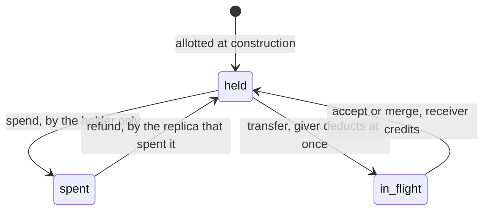
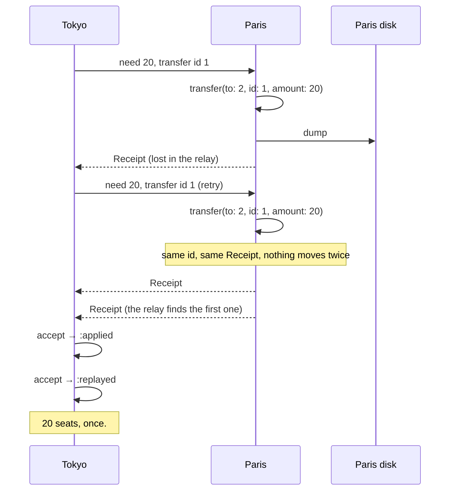

# EscrowMachines

> You cannot sell the seat twice if you only ever sell the seats you are holding. 🏦

A rights ledger for Ruby replicas that can't always talk to each other. A fixed set of replicas shares a fixed supply: seats, credits, stock, quota. Each replica holds part of it and spends only from its own part, with no round trip to anyone. Rights move between replicas by transfer, never by wishful thinking. Merge the replicas in any order, any number of times, and they agree. The total spent never exceeds the supply, partitioned or not.

## Quick Start

```bash
gem 'escrow_machines'
```

```ruby
# 100 seats, three regions. Every region builds the same allotment.
paris = EscrowMachines::Escrow.new(replica: 0, rights: [60, 30, 10])
tokyo = EscrowMachines::Escrow.new(replica: 2, rights: [60, 30, 10])

tokyo.spend(8)    # => 2, seats left in Tokyo
tokyo.spend(5)    # => :insufficient. Paris has 60. Tokyo has 2.

receipt = paris.transfer(to: 2, id: 1, amount: 20)
save(paris.dump)                # persist before the receipt leaves the building
tokyo.accept(receipt)           # => :applied
tokyo.accept(receipt)           # => :replayed, the relay stuttered
tokyo.spend(5)                  # => 17
```

One escrow per replica. Amounts, replica indexes and transfer ids are Integers. No clock, no network, no storage: you bring those.

## A Message to the Resistance

So you have a hundred seats and three regions, and you put the count in a replicated counter because the conference talk said CRDTs never conflict. They don't. Each region decremented happily through a forty-second partition, the counters merged without a single conflict, and the merged value was minus eleven. Eleven people are now standing in a lobby holding a confirmation email.

A PN-counter converges. Converging on a negative number is still converging. What it can't do is say no, because saying no requires knowing something about the other replicas, and the entire point was not asking them.

The other fix is asking them: a lock, a leader, a quorum on every sale. Now Tokyo can't sell a seat while the link to Paris is down, which is the outage you bought replicas to avoid.

There's a third option from 1986. Split the hundred up front. Each replica owns a share and sells from its share alone. A replica that runs low asks a neighbour for some of theirs, and the neighbour gives away only what it still holds. Nobody ever needs a global answer, because nobody ever spends a right they aren't holding. That's escrow, and the bookkeeping for it is this gem.

## Chapter 1: Stardate 2026.316, the AMS O'Neil

> **AMS O'Neil**, NCC-4233, *O'Neil*-class treasury escort.
> The hold carries what was counted aboard. Nothing more is for sale.

The escort doesn't make money. It moves a counted amount between stations and refuses to let anyone spend a chit that isn't physically in the hold. Each station's strongbox has one keyholder. A station can hand chits to another station and log the handover; it cannot reach into someone else's box, and it cannot print.

On a bridge somewhere, a cadet volunteers:

```ruby
def sell(region, seats)
  counter = PNCounter.for(:seats)
  return :sold_out if counter.value < seats
  counter.decrement(region, seats)
end
```

"That," says the escort's purser, "checks a number three stations are changing, and then changes it. You've sold the same eleven seats in three time zones."

## The Flight Plan

Every right in the supply is in exactly one place at any moment:



Held plus spent plus in flight always equals the supply. Nothing mints, nothing leaks, and an in-flight right belongs to nobody until its receipt lands.

And the afternoon Tokyo ran low while the relay was repeating itself:



## How the Escrow Works

### Spend

```ruby
escrow = EscrowMachines::Escrow.new(replica: 0, rights: [10, 5])

escrow.spend(7)     # => 3, what this replica has left
escrow.spend(4)     # => :insufficient
escrow.available    # => 3
```

`spend` looks at one number: what this replica holds. The other replica's 5 are not part of the question. A refused spend changes nothing.

### Refund

```ruby
escrow.refund(2)    # => 5, back in this replica's hold
escrow.refund(6)    # => :exceeds_spent
escrow.outstanding(0)   # => 5, spent and not refunded
```

A refund returns rights this replica spent. It can't return more than that, because that would be printing. Refund where you spent: the rights come back to the replica that let them go.

### Transfer

```ruby
left  = EscrowMachines::Escrow.new(replica: 0, rights: [10, 0])
right = EscrowMachines::Escrow.new(replica: 1, rights: [10, 0])

receipt = left.transfer(to: 1, id: 1, amount: 4)
receipt   # => #<data EscrowMachines::Receipt from=0, to=1, id=1, amount=4, total=4>
left.available                          # => 6, deducted now

left.transfer(to: 1, id: 1, amount: 4)  # => the same Receipt. Nothing moved again.
left.transfer(to: 1, id: 1, amount: 9)  # => :id_conflict
left.transfer(to: 1, id: 0, amount: 4)  # => :stale_id
left.transfer(to: 1, id: 2, amount: 7)  # => :insufficient
```

You choose the id. It has to go up for each destination, and a retry reuses the one it's retrying. The latest id is answered with its original receipt for as long as it stays the latest. Anything older is `:stale_id`: refused, not repeated.

### Accept

```ruby
right.accept(receipt)   # => :applied
right.accept(receipt)   # => :replayed
right.available         # => 4
```

A receipt says how much `from` has granted `to` in total, not "add four". Deliver it twice, deliver it after a newer one, deliver it to a bystander: the answer is the same grant. A receipt that contradicts what the replica already knows is `:malformed`, `:id_conflict`, or `:forged`, and changes nothing.

### Merge

```ruby
right.spend(1)
left.merge(right)       # => true
left.balance(1)         # => 3, what left now believes right holds
left.available          # => 6, still only its own
```

`merge` folds in everything another replica knows. Any order, any number of times, any gossip topology. It never makes someone else's rights spendable here. `balance` for another replica is an estimate, and it can be negative when you've seen rights leave a replica before you've seen them arrive there.

### Persist, and what happens when you didn't

```ruby
frame = left.dump                             # binary String, fixed length
left  = EscrowMachines::Escrow.load(frame)    # ArgumentError if it isn't a sane frame
```

A replica that restarts from an old frame has forgotten spends it already made. The first peer that remembers them proves it:

```ruby
stale = EscrowMachines::Escrow.load(old_frame)
stale.merge(right)      # => :diverged, and stale is untouched
stale.recover(right)    # => true, adopts what right saw of it
                        # => :overdrawn if the two histories can't both be true
```

`recover` is a decision, which is why it isn't `merge`. It restores what some peer witnessed. A spend that never left the lost replica is gone, and no method can find it.

### Capacity

```ruby
EscrowMachines::CAPACITY                                     # => 8
EscrowMachines::Escrow.new(replica: 0, rights: [1] * 9)      # RangeError
```

Up to eight replicas, fixed when you build the escrow. The set doesn't grow, shrink, or rename itself afterwards.

## The Rules of the Escort

- **Everything is an Integer** in `0..2**64-1`: amounts, replica indexes, ids. Floats, nil and strings raise `TypeError`. Out of range raises `RangeError`. So does an allotment that adds up past `2**64-1`.
- **Same allotment everywhere.** Every replica is built from the same `rights:` array. Views built from different ones answer `:config_mismatch` and don't merge.
- **Refusals don't raise.** `:insufficient`, `:exceeds_spent`, `:zero_amount`, `:unknown_replica`, `:self_transfer`, `:stale_id`, `:id_conflict`, `:malformed`, `:forged`, `:config_mismatch`, `:diverged`, `:overdrawn` and `:overflow` are answers. A refused call leaves the escrow exactly as it was.
- **Counters are lifetime totals.** Grants and spends only count up. A pair that has moved `2**64-1` rights between them over the years answers `:overflow` instead of wrapping.
- **Frozen means frozen.** `freeze` the escrow and `spend`, `refund`, `transfer`, `accept`, `merge` and `recover` raise `FrozenError`.

## What You Think You're Doing vs Reality

### You Think: "CRDTs can't conflict, so my counter is safe."
### Reality: It merged cleanly to minus eleven.

Convergence means everyone ends up with the same number. It doesn't mean the number is one you can live with. An invariant like "never below zero" is a promise about the sum of decisions made by replicas that can't see each other, and the only way to keep it without asking is to hand each replica a budget in advance. That's the difference between a counter and an escrow: one records what happened, the other can refuse.

### You Think: "The transfer timed out, so I'll send it again with a new id."
### Reality: Now two transfers happened.

The id is the transfer's name. A retry is the same transfer, so it has the same name. A new id is a new transfer, and Paris will cheerfully send another twenty.

## What's Yours

This is an early release of a policy core. The API will change. It decides; it doesn't run anything.

**Durable replica identity is yours.** `dump` the escrow and get it onto disk before you act on a successful `spend`, `refund` or `transfer`, and before a receipt leaves the process. A replica that comes back from an older frame under the same index can spend the same rights twice, and `:diverged` only tells you after a peer notices. Never run two live processes as the same replica.

**Transfer ids are yours.** Per destination, strictly increasing, reused on retry. Only the latest id for a pair replays; keep your retries ahead of your next request.

**Transport is yours.** Receipts and frames are values. How they cross the wire, who asks whom for rights, and how much to ask for are your call. Rights in flight are spendable by nobody until the receipt or a merge arrives, so a lost receipt strands rights until gossip catches up.

**Authenticity is yours.** `accept` and `merge` catch contradictions, not liars. A fabricated receipt from a replica that never granted anything will be believed. Don't accept frames from anyone you wouldn't hand the strongbox key.

**Membership is yours.** The replica set is fixed. Retiring a replica means transferring its rights out first and never using the index again.

## License

MIT License. See [LICENSE.txt](LICENSE.txt) for details.

**Remember: the counter will merge either way. The question is whether it ever said no.**
